# watch-and-learn

[](https://github.com/ec6862/watch-and-learn/actions/workflows/ci.yml)

Learn a language from the shows/videos you already watch on your browser and phone!

watch-and-learn is a desktop overlay (mobile planned) that shows live captions for whatever is
playing on your computer. Click a word you don't know and it's saved to your
word bank. When you're done, the web app gives you each word's pinyin, a definition, and example sentences, and (soon) turns them into
spaced-repetition flashcards on web and mobile. Chinese is the first language.

> **Status:** early development (Phase 0 of 10: foundations). See the
> [roadmap](#roadmap) for what exists today and what's planned.

## Why I built this

### Backgrounds

I originally grew up speaking Chinese with my grandparents back in China, who took care of me as my parents worked in the U.S. As I grew older and came back to America at the age of 5, I found that both my parents were very busy providing for the family working 9 a.m. to 9 p.m., seven days a week, and because of that, we could only communicate at the dinner table. As I grew to speak less Chinese and more English, I lost a lot of my native tongue and found myself expressing more with my English-speaking friends more than my own family. Over time, I became unable to express myself at the dinner table with my very own parents that sacrificed their future for me.

As I transitioned through my different phases in life, I found that many of my friends were able to better learn Chinese through talking to others every day, attending Chinese schools, and consuming Chinese entertainment. Growing up, I wasn't particularly interested in any of these. However, as I grow older and look back at my memories with my families and friends growing up, I've begun to realize the importance spending time with those that come and leave through the different phases in my life, and wish to now enjoy my time with them before they enter a different phase in theirs. To that end, I wanted to build a project that can grow my understanding of my background and culture, and help me become fluent in it as I grow to embrace the culture that my grandparents and parents grew up with in China.

### The problem

Learning vocabulary from real content is the fun part of learning a language,
but it's also the most tedious one. Every new word means pausing the video and trying
to look it up: guessing the pinyin, scrolling past characters that sound the
same, and working out where one word ends and the next begins. By the time you press play again, the moment is
gone, and you still don't know how to really use the word.

watch-and-learn removes those steps: **hear it → click it in the transcript → it's saved, with
context.** Lookups and study happen later, when you're not trying to follow a
story.

This is my portfolio project that I came up with to challenge myself. I wanted something that spans the full stack
I want to work in: a desktop app, a real-time backend, a web app, and a
mobile app, all sharing typed code in a single monorepo.

## How it works

1. **Capture:** The Electron desktop app captures system audio and streams it
   to the backend.
2. **Transcribe:** The NestJS API forwards the audio to a speech-to-text
   service and sends captions back over a WebSocket.
3. **Save:** Captions appear in a transparent, always-on-top overlay. Click a
   word to save it. Click **Done** to end the session.
4. **Learn:** The session opens in the web app with the full transcript and
   a word bank. AI fills in each word's pinyin, definition, and example
   sentences.
5. **Review** _(planned):_ Spaced-repetition flashcards on the web and in an
   Expo mobile app.

```mermaid
flowchart LR
  subgraph pc["User's computer"]
    media["Video or show<br/>(any app)"]
    subgraph desktop["apps/desktop · Electron"]
      mainproc["Main process<br/>window + audio permission"]
      overlay["Overlay · React<br/>captions, hover, select, pinyin"]
    end
  end

  subgraph api["apps/api · NestJS"]
    ws["WebSocket gateway"]
    stt["Transcription service<br/>(provider interface)"]
    seg["Word segmentation<br/>Intl.Segmenter"]
    rest["REST endpoints"]
    enrich["AI enrichment"]:::planned
  end

  provider["Speech-to-text<br/>AWS Transcribe or Deepgram"]
  llm["LLM provider"]:::planned
  db[("PostgreSQL<br/>transcripts + saved words<br/>no audio")]

  web["apps/web · Next.js<br/>transcript + word bank"]
  mobile["apps/mobile · Expo<br/>flashcard review"]:::planned

  subgraph shared["packages/ (imported by every app)"]
    config["@wal/config"]
    types["@wal/types"]
    zh["@wal/zh<br/>CC-CEDICT + pinyin"]:::planned
    client["@wal/api-client"]:::planned
    srs["@wal/srs"]:::planned
  end

  media -->|"system audio (loopback)"| overlay
  mainproc -.->|"grants loopback audio"| overlay
  overlay -->|"audio chunks over WebSocket"| ws
  ws --> stt
  stt <--> provider
  stt -->|"final text"| seg
  seg --> db
  ws -->|"captions + word boundaries"| overlay
  overlay -->|"save word"| rest
  rest --> db
  web -->|"REST"| rest
  mobile -->|"REST"| rest
  rest --> enrich
  enrich --> llm
  overlay -.->|"Done: open session"| web

  classDef planned stroke-dasharray: 5 5
```



## Design decisions

The reasoning behind each choice is recorded as an Architecture Decision
Record in [`docs/adr/`](docs/adr/).

- **Text only, never audio.** Audio is streamed for transcription and then
  discarded. Only transcript text and saved words are stored. This keeps
  storage small and avoids holding copies of copyrighted media or anyone's
  voice.
- **Speech-to-text goes through the backend.** The desktop app never holds
  cloud API keys. The backend owns credentials and can switch providers
  (AWS Transcribe or Deepgram) without shipping a new desktop build.
- **Electron for the overlay.** A transparent, click-through, always-on-top
  window plus system audio capture, written in the same TypeScript as the
  rest of the stack.
- **A local dictionary for instant lookups.** Captions are split into words
  on the backend. Hover translations and pinyin come from a bundled
  CC-CEDICT dictionary, so they're instant and free. AI is saved for the
  web app, where it explains words in context.
- **One TypeScript monorepo.** pnpm workspaces + Turborepo let the desktop,
  web, mobile, and API apps share types (validated with zod), an API client,
  and spaced-repetition logic, so a change to a shared type is checked
  everywhere at once.

## Tech stack

| Area           | Tools                                                     |
| -------------- | --------------------------------------------------------- |
| Monorepo       | pnpm workspaces, Turborepo                                |
| Desktop        | Electron                                                  |
| API            | NestJS (REST + WebSocket)                                 |
| Web            | Next.js                                                   |
| Mobile         | Expo (React Native), review only                          |
| Data           | PostgreSQL 18 (Docker for local development)              |
| Speech-to-text | AWS Transcribe or Deepgram, via the backend               |
| Shared code    | `@wal/types` (zod), API client, spaced repetition, config |
| Quality        | TypeScript (strict), ESLint, Prettier, Husky, lint-staged |
| Commits & CI   | commitlint (Conventional Commits), GitHub Actions         |

## Repository layout

```
watch-and-learn/
├── apps/            # desktop (Electron), api (NestJS), web (Next.js), mobile (Expo)
├── packages/
│   ├── config/      # shared tsconfig, ESLint, and Prettier config (@wal/config)
│   └── types/       # shared domain types (@wal/types)
├── docs/adr/        # Architecture Decision Records
└── infra/           # docker-compose for local Postgres
```

## Getting started

### Prerequisites

- **Node.js 26** (version pinned in `.node-version`; [fnm](https://github.com/Schniz/fnm)
  recommended, which picks it up automatically)
- **pnpm**, the version pinned in `package.json` (`packageManager`). Run
  `corepack enable` to use it
- **Docker Desktop**, for local Postgres

### Setup

```bash
git clone https://github.com/YOUR-GITHUB-USERNAME/watch-and-learn.git
cd watch-and-learn
pnpm install
cp .env.example .env     # on Windows PowerShell: Copy-Item .env.example .env
pnpm db:up               # starts Postgres and waits until it's healthy
```

### Scripts

| Command                | What it does                                     |
| ---------------------- | ------------------------------------------------ |
| `pnpm turbo build`     | Build every package and app                      |
| `pnpm turbo lint`      | Run ESLint across the monorepo                   |
| `pnpm turbo typecheck` | Type-check everything                            |
| `pnpm format`          | Format all files with Prettier                   |
| `pnpm format:check`    | Check formatting without changing files (CI)     |
| `pnpm db:up`           | Start local Postgres (Docker) and wait for ready |
| `pnpm db:down`         | Stop Postgres (data is kept in a volume)         |
| `pnpm db:logs`         | Follow Postgres logs                             |

## Quality gates

Every change goes through the same checks locally and in CI:

- **On commit:** Husky runs lint-staged (ESLint + Prettier on staged files
  only) and commitlint (Conventional Commit messages, e.g. `feat:`, `fix:`,
  `docs:`).
- **On push and pull request:** GitHub Actions installs with a frozen
  lockfile and runs build, lint, typecheck, and a formatting check.

## Roadmap

A 10-week plan across Phases 0–9.

- ✅ Monorepo, shared config and types
- ✅ Quality gates: Husky, lint-staged, commitlint, CI
- ✅ Local Postgres in Docker
- ✅ Architecture docs: ADRs and diagram
- ⏳ Electron overlay with live captions
- ⏳ NestJS API with streaming speech-to-text
- ⏳ Web app: transcript and AI-enriched word bank
- ⏳ Spaced-repetition flashcards (web + Expo mobile)

## License

All rights reserved for now. A license will be added before the first release.
