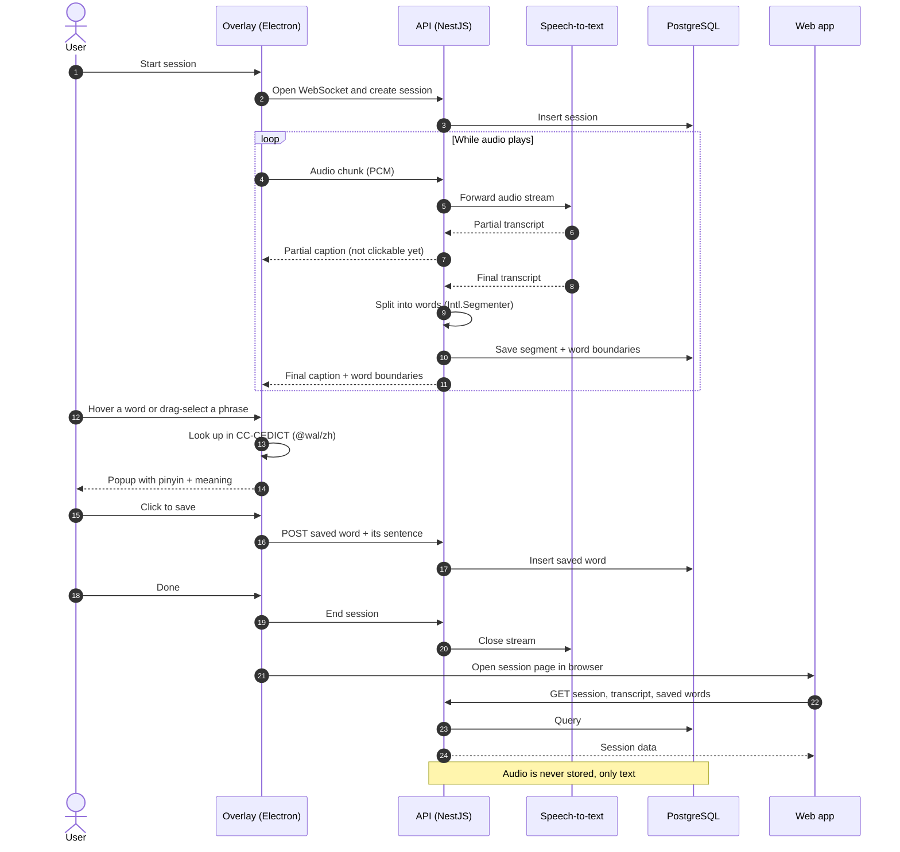

# Architecture

The system overview diagram is in the [README](../README.md#how-it-works).
This page shows what happens over time during one session. The reasoning
behind each part is in the [ADRs](adr/).

## One session, step by step

## Walkthrough

1. **Start (1–3):** The overlay opens a WebSocket to the API, which creates
   a session row.
2. **Live captions (4–11):** Audio is streamed in small chunks. The
   speech-to-text provider returns _partial_ results that may still change.
   These are shown but not clickable. When a result is _final_, the API
   splits it into words, saves it, and sends it to the overlay with word
   boundaries ([ADR 0002](adr/0002-speech-to-text-via-backend-with-text-only-storage.md),
   [ADR 0004](adr/0004-chinese-word-segmentation-and-dictionary-lookup.md)).
3. **Look up (12–14):** Hovering or drag-selecting looks the text up in a
   local dictionary inside the overlay. There is no network call, so the
   popup is instant.
4. **Save (15–17):** Clicking saves the word with the sentence it came from.
5. **Done (18–25):** The session ends, the speech-to-text stream closes, and
   the session opens in the web app, which loads it over REST.
